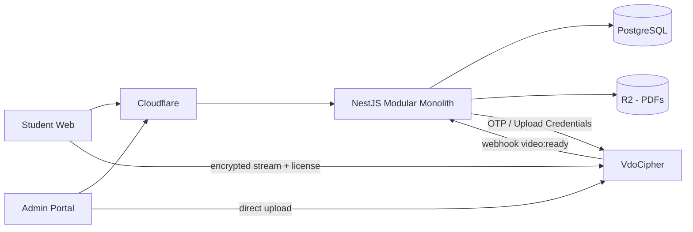
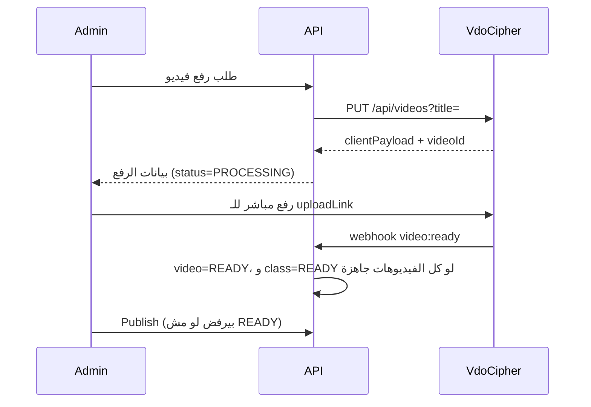

# Online Class Platform: خطة الـ Backend للـ MVP

**المالك:** Mahmoud Nasr (Tech Lead)
**المرجع:** ملفات `MVP-5Weeks Sprint` (PRD, Roles, Business Rules, Use Cases, Flows & Wireframes)
**المدة:** 5 أسابيع من يوم الـ kickoff
**الحالة:** Draft، محتاجة قرارات القسم 2 من الـ BA

---

## 1. الخلاصة

- **الشكل:** Modular Monolith واحد، بيخدم Student API و Admin API.
- **المشروع أهم حاجتين فيه:** الفلوس (Wallet + Scratch Codes) والمحتوى (DRM + منع مشاركة الحساب). دول اللي بياخدوا أكبر عناية واختبارات.
- **البلان دي بتفترض حاجتين لسه محدش أكدهم:** الـ stack المقترح في القسم 3، وإن فيه شخص تاني ماسك الـ Frontend.
- **أكبر خطر حالياً:** الـ Scope. ملف الـ Roles فيه features أكتر بكتير من الـ PRD، ومش هتتعمل كلها في 5 أسابيع (القسم 4).

---

## 2. قرارات لازم تتحسم قبل الكود

الملفات متعارضة في النقط دي. لو الـ BA ماردش، هنمشي بالـ Default عشان الشغل مايقفش.

### 2.1 تعارضات بتأثر على الـ Schema (تتحسم في أول يومين)

| # | التعارض | Default المقترح |
|---|---|---|
| D1 | شكل الكود: PRD و BR-W01 بيقولوا **14 رقم**، و Roles بيقول **11 حرف/رقم** من غير `0,O,1,I` | **14 رقم** (مذكور في PRD و BR و Wireframes، وأسهل في الكتابة من كارت مطبوع) |
| D2 | نوع الكود: Roles بيقول قيمة مالية **أو** فتح محاضرة مباشرة. BR-AD04 قيمة مالية بس | **قيمة مالية بس** في الـ MVP |
| D3 | الـ Hierarchy: Package في PRD، و Monthly Bundles/Chapters/Lectures في Roles، و Class في BR | `Chapter > Class`، والـ **Class هي الوحدة اللي بتتباع** (فيديو أو أكتر + PDFs + Homework). الـ Bundles في Phase 2 |
| D4 | SaaS و White-label و "Tenant" مقابل مدرس واحد في كل الـ Journeys | **Deployment و DB منفصلين لكل مدرس**، من غير `tenant_id` |
| D5 | الكورسات المجانية: موجودة في Roles بس، ومفيش ليها Flow | `price = 0`، والـ Enrollment بيتعمل من غير حركة Wallet |

### 2.2 تعارضات بتأثر على الـ Logic (تتحسم قبل نهاية أسبوع 1)

| # | التعارض | Default المقترح |
|---|---|---|
| D6 | الجهاز التالت: PRD بيقول "Log out from another device first"، والـ Flow بيقول يكلم الدعم | **الدعم بس.** لو الـ Logout بيحرر مكان، الطلاب هيتبادلوا الحساب بسهولة. الـ Logout بينهي الـ Session بس والجهاز يفضل مسجل |
| D7 | Roles: "Simultaneous multi-device login must be blocked" مقابل جهازين Active | **جهازين مسجلين و Session واحدة شغالة.** الدخول من الجهاز التاني بينهي الأول |
| D8 | تغيير الموبايل: BR-AD09 بيطلب OTP للأب، بس مفيش SMS Provider في الـ Scope. الـ Flow بيقول OTP/Manual | **تحقق يدوي** (مكالمة لرقم ولي الأمر) مع سبب إجباري و Audit. مفيش SMS في الـ MVP |
| D9 | مين يعمل Publish: الـ Wireframe بيقول Super Admin بس، والـ Flow بيقول Permission | **Permission** `class.publish`، ومقفولة افتراضياً للـ Assistant |
| D10 | إلغاء الأكواد: Roles بيسمح للـ Assistant، والـ Wireframe بيقول Super Admin بس | **Permission** `code.deactivate`، ومقفولة افتراضياً للـ Assistant، مع Audit |
| D11 | BR-W06 فيها "expired" لكن مفيش أي قاعدة لانتهاء الأكواد | الأكواد **مالهاش expiry** في الـ MVP |
| D12 | حالة Enrollment فيها "refunded" لكن مفيش Refund Flow | Refund يدوي بصلاحية Super Admin فقط، بحركة عكسية في الـ Ledger |
| D13 | Homework: لينك فورم في PRD، و MCQ بتصحيح تلقائي في Roles | **لينك خارجي** في الـ MVP |

### 2.3 نقط في الـ Requirements محتاجة تتعدل

1. **Success Metric "0% تسريب" مش قابل للتحقيق ولا للقياس.** الـ DRM بيمنع تحميل الملف، لكن مفيش حاجة بتمنع تصوير الشاشة بموبايل تاني. الـ Watermark هو اللي بيحدد مين سرّب. المقترح: "0 ملفات قابلة للتشغيل عن طريق التحميل المباشر" + "كل تسريب نقدر نتتبعه لصاحبه".
2. **الـ Watermark بالرقم المتغطي بس (BR-CP09) مش بيحدد الطالب بشكل قاطع**، لأن طالبين ممكن يتشابهوا في `010****1234`. المقترح: إضافة `short_id` زي ما الـ Wireframe عامل (`Student ID - 010****1234`).
3. **"100% تطابق بين الأكواد والكاش" محتاج بيانات مش موجودة.** السيستم يعرف المولد والمستخدم، لكن مايعرفش الكاش اللي اتسلم. المقترح: جدول بسيط `batch_settlements` يسجل فيه المدرس المبلغ اللي استلمه لكل Batch.
4. **الـ Manual Top-up برّه تقرير الأكواد.** لازم يبقى له تقرير منفصل بالـ Assistant، وليه سقف يومي قابل للتعديل، لأنه أسهل طريق للتلاعب.
5. **Hard Delete للمدرس بيتعارض مع سلامة الماليات.** المقترح: مسموح بس للي مالوش حركات مالية. الـ Ledger والـ Audit مايتمسحوش أبداً.
6. **مفيش تحقق من ملكية الموبايل عند التسجيل.** أي حد يقدر يسجل برقم غيره، وصاحب الرقم الحقيقي هيتمنع. مقبول للـ MVP، بس لازم يتسجل كـ Known Risk.
7. **الطلبة 16-18 سنة.** قانون حماية البيانات المصري (151/2020) بيشترط موافقة ولي الأمر لبيانات الأطفال، واللائحة صدرت نوفمبر 2025 بفترة توفيق سنة. **لازم مراجعة محامي قبل الإطلاق.** من ناحيتنا هنسجل نسخة وتوقيت الموافقة في الـ DB.
8. **صياغة BR-AD06 ناقصة:** المقصود "لا يتم النشر **إلا بعد** اكتمال التشفير".

---

## 3. الـ Tech Stack المقترح

| الطبقة | الاختيار | السبب |
|---|---|---|
| Framework | NestJS + TypeScript | Modules و Guards مناسبين جداً للـ RBAC |
| Database | PostgreSQL | Transactions و Row Locks و Partial Indexes بتغطي BR-W09/W10/CP04 |
| ORM | Prisma + Raw SQL للعمليات المالية | سرعة في الـ CRUD وتحكم كامل في الـ Conditional Updates |
| Jobs | pg-boss | Queue جوه Postgres، من غير Redis في الـ MVP |
| Video DRM | VdoCipher | مذكور في الـ PRD، وبيغطي Upload و Encryption و Player و Watermark |
| Files (PDF) | S3-compatible (Cloudflare R2) + Signed URLs قصيرة | BR-CP10 |
| Sessions | Opaque Token في `httpOnly` Cookie، والـ Hash في الـ DB | إلغاء فوري مطلوب في BR-AD08، وده صعب مع JWT |
| Passwords | Argon2id | |
| Hosting | Docker على VPS + Managed Postgres بـ Point-in-Time Recovery + Cloudflare | بسيط، والـ Backup مهم لأن فيه فلوس |
| Monitoring | Sentry + Structured Logs + Uptime Check | |

**مش هنستخدم في الـ MVP:** Microservices، Kafka، Redis، JWT.

---

## 4. الـ Scope

| داخل الـ MVP | Phase 2 (موجود في Roles بس) | خارج تماماً (PRD) |
|---|---|---|
| Register / Login / جهازين | MCQ Exams و Auto-grading و Prerequisites | Payment Gateways |
| Wallet و Scratch Codes و Manual Top-up | Comments و Q&A تحت الفيديوهات* | Native Apps |
| Catalog و Purchase و Enrollment | Max Views و Watch-time Quota | Live Streaming |
| DRM Playback + Watermark | Monthly Bundles | Chat / Forums |
| PDFs + Homework Link | Lecture-unlock Codes | |
| Admin: Upload و Publish و Student Lookup | Tags و Filtering المتقدم | |
| Device Reset و Password Reset و Phone Change | White-label UI كامل (في الـ MVP ENV و Settings بسيطة) | |
| RBAC و Permissions لكل Assistant | Timed Quizzes | |
| Audit Log و Financial Dashboard و Batch Reconciliation | | |

\* الـ Comments متعارضة مع "In-Platform Chat/Forums: Out of scope" في الـ PRD.

---

## 5. الـ Architecture



```text
src/
  auth/        register, login, sessions, password
  devices/     registered devices, reset
  users/       students, staff, lookup, masking
  rbac/        roles, permissions, guards
  wallet/      balance, ledger, redeem, manual top-up
  codes/       batches, generation, export, lookup, deactivate
  catalog/     chapters, classes, publish states
  enrollment/  purchase, access checks
  media/       vdocipher, upload, webhook, playback
  materials/   PDFs, homework links
  reports/     financial dashboard, reconciliation
  audit/       append-only audit log
  events/      analytics events
  settings/    device limit, watermark, maintenance mode
```

**قواعد:**
- الـ Module مايلمسش جداول Module تاني مباشرة، بينادي الـ Service بتاعه.
- `@RequirePermission('...')` على كل Admin Endpoint (BR-AD02).
- كل فلوس بـ **قروش كـ Integer**. مفيش Float.

---

## 6. الـ Data Model

| الجدول | أهم الأعمدة | ملاحظات |
|---|---|---|
| `users` | id, short_id, role, name, phone (unique), password_hash, status, failed_login_count, login_locked_until, must_change_password, deleted_at | STUDENT / ASSISTANT / SUPER_ADMIN |
| `student_profiles` | user_id, parent_phone, grade, consent_version, consent_at | CHECK: `parent_phone` غير `phone` في الـ Service |
| `staff_permissions` | user_id, permission | Toggles لكل Assistant |
| `devices` | id, user_id, device_token_hash, label, first_seen, last_seen, revoked_at | |
| `sessions` | id, user_id, device_id, token_hash, expires_at, revoked_at | |
| `wallets` | user_id PK, balance_piastres `CHECK >= 0` | |
| `wallet_transactions` | id, user_id, type, amount_piastres, balance_after, ref_type, ref_id, operator_id, note, created_at | **Append-only** |
| `redeem_guards` | user_id PK, failed_count, locked_until | BR-W05..W08 |
| `code_batches` | id, value_piastres, quantity, created_by, status, exported_at, export_blob, export_expires_at | `export_blob` مشفر ومؤقت |
| `scratch_codes` | id, batch_id, code_hash (unique), last4, value_piastres, status, redeemed_by, redeemed_at | ACTIVE / REDEEMED / DEACTIVATED |
| `batch_settlements` | id, batch_id, amount_piastres, recorded_by, created_at | حسب قرار 2.3 |
| `chapters` | id, title, grade, sort | |
| `classes` | id, chapter_id, title, grade, price_piastres, status, deleted_at | DRAFT / PROCESSING / READY / PUBLISHED / FAILED / DISABLED |
| `videos` | id, class_id, provider_video_id (unique), status, length_sec | |
| `materials` | id, class_id, type, storage_key أو url, is_downloadable | PDF / HOMEWORK_LINK |
| `enrollments` | id, user_id, class_id, status, source, price_paid_piastres | Partial Unique على (user, class) لما `status='ACTIVE'` (BR-CP02) |
| `audit_logs` | id, operator_id, action, target_type, target_id, metadata, ip, created_at | **Append-only** |
| `events` | id, name, user_id, properties, created_at | جدول الـ Tracking في الـ PRD |
| `settings` | key, value | Device limit، Watermark، Maintenance |

**Append-only على مستوى الـ DB (BR-AD10):**

```sql
CREATE FUNCTION forbid_change() RETURNS trigger AS $$
BEGIN RAISE EXCEPTION 'append-only table'; END;
$$ LANGUAGE plpgsql;

CREATE TRIGGER audit_immutable
BEFORE UPDATE OR DELETE ON audit_logs
FOR EACH ROW EXECUTE FUNCTION forbid_change();
-- ونفس الـ trigger على wallet_transactions
```

**مهم:** مفيش `ON DELETE CASCADE` من `users` أو `scratch_codes` لأي جدول مالي. الربط `RESTRICT`.

---

## 7. الـ Flows الحساسة

### 7.1 Redeem Code (BR-W01..W10)

Transaction واحدة، و`FOR UPDATE` على الـ Guard بتمنع نفس الطالب من تخطي العداد بطلبات متزامنة. فشل الكود مش بيعمل Rollback، فالمحاولة الغلط بتتسجل صح.

```sql
BEGIN;
SELECT failed_count, locked_until FROM redeem_guards
WHERE user_id = $user FOR UPDATE;
-- locked_until > now()      => COMMIT + 423 Locked
-- locked_until انتهى         => صفّر العداد (BR-W08)

UPDATE scratch_codes
SET status = 'REDEEMED', redeemed_by = $user, redeemed_at = now()
WHERE code_hash = $hmac AND status = 'ACTIVE'
RETURNING id, value_piastres, last4;

-- لو 0 صفوف: زوّد failed_count، ولو وصل 5 حدد locked_until = now()+15min
--            سجل invalid_code_attempt، COMMIT، ورجّع خطأ
-- لو نجح:
UPDATE wallets SET balance_piastres = balance_piastres + $value
WHERE user_id = $user RETURNING balance_piastres;
INSERT INTO wallet_transactions (...);
UPDATE redeem_guards SET failed_count = 0, locked_until = NULL
WHERE user_id = $user;
COMMIT;
```

### 7.2 Purchase (BR-CP01..CP05)

```sql
BEGIN;
-- تأكد إن الـ class حالتها PUBLISHED
UPDATE wallets SET balance_piastres = balance_piastres - $price
WHERE user_id = $user AND balance_piastres >= $price
RETURNING balance_piastres;          -- 0 صفوف => Rollback + "Recharge Wallet"
INSERT INTO enrollments (...);       -- unique violation => Rollback + "Already enrolled"
INSERT INTO wallet_transactions (...);
COMMIT;
```

السعر بيتقرا من الـ DB دايماً، مش من الـ Request.

### 7.3 توليد الأكواد (BR-AD03..AD05)

1. التوليد بـ `crypto.randomInt` (مش `Math.random`).
2. التخزين: `HMAC-SHA256(code, SERVER_PEPPER)`. **مش bcrypt**، لأننا محتاجين بحث مباشر بالكود. **ومش SHA عادي**، لأن 10^14 احتمال ممكن تتجرب كلها لو الـ DB اتسربت.
3. الـ `SERVER_PEPPER` في Secret Manager/ENV، مش في الـ DB.
4. `last4` بس بيتخزن واضح (للـ Ref في شاشة الـ Wallet).
5. الـ Unique Index على `code_hash` بيحسم التكرار، ولو حصل Collision نولّد تاني.
6. **Export مرة واحدة:** الأكواد الخام بتتخزن مشفرة (AES-256-GCM) في `export_blob` لمدة 24 ساعة كحد أقصى. أول Download بيعمل Claim ذري (`WHERE exported_at IS NULL`) والـ Blob بيتمسح. لو الملف ضاع: إلغاء الـ Batch وتوليد واحدة جديدة.
7. حد أقصى للـ Batch (مقترح 5000 كود) وللـ Assistant في اليوم، قابلين للتعديل.

### 7.4 Login والأجهزة

```text
1. فحص القفل (5 محاولات = 15 دقيقة) + Rate limit بالـ IP
2. Argon2 verify
3. فحص حالة الحساب
4. قراءة device cookie:
     مسجل            => كمل
     جديد و < الحد    => سجله
     جديد و >= الحد   => 403 DEVICE_LIMIT + event
5. إلغاء باقي الـ Sessions (D7) + إنشاء Session جديدة
```

**الـ Device ID:** Token عشوائي 256-bit في `httpOnly, Secure` Cookie عمرها طويل.
الـ Browser Fingerprint مش معتمد كمعرّف أساسي لأنه بيتغير مع التحديثات.

**خطر على الـ Guardrail (أقل من 5%):** مسح الـ Cookies أو Incognito بيتحسب جهاز جديد. هنقيس `device_limit_denied` و عدد الـ Resets من أول يوم، ونوضح للطالب ماينفعش يستخدم Incognito.

### 7.5 Reset Devices (BR-AD08)

في Transaction واحدة: `revoked_at` على الأجهزة والـ Sessions + Audit `devices_reset`. تغيير الموبايل وتغيير الباسورد بنفس المنطق.

### 7.6 رفع الفيديو ونشره (BR-AD06)



- الـ Webhook URL فيه Token سري نتأكد منه، لأن توثيق VdoCipher بيقترح كده ومفيش توقيع موثق.
- الـ Handler لازم يبقى Idempotent، ومايعتمدش على شكل ثابت للـ Payload.
- **Job كل 10 دقايق** يسأل عن الفيديوهات المعلقة، لأن الـ Webhook ممكن يضيع. ومفيش Event موثق للفشل، فالمعلق فترة طويلة يتحول `FAILED`.

### 7.7 Playback (BR-CP06..CP09)

1. تأكد إن الـ Session سليمة، والـ Enrollment `ACTIVE`، والفيديو `READY`.
2. `POST /api/videos/{id}/otp` من الـ Backend بـ `Authorization: Apisecret ...`، و `ttl: 300`، و `annotate`:

```js
const annotate = JSON.stringify([{
  type: 'rtext',
  text: `${user.shortId} ${maskPhone(user.phone)}`,
  alpha: settings.watermarkAlpha,
  color: '0xFFFFFF',
  size: '15',
  interval: '5000',
}]);
```

3. رجّع `otp` و `playbackInfo` للـ Frontend. **الـ API Secret مايخرجش من الـ Backend أبداً.**
4. Rate limit على الـ Endpoint ده، لأن كل طلب ليه تكلفة ومؤشر على مشاركة حساب.

**ملحوظة:** الـ Backend يعرف إن الـ OTP اتطلب، مش إن الفيديو اشتغل. `video_started` لازم يتبعت من الـ Player، أو نغير اسمه لـ `playback_authorized`.

### 7.8 الـ Materials (BR-CP10)

`GET /classes/:id/materials/:mid` بيعمل فحص Enrollment مستقل وبيرجع Signed URL (مقترح 60 ثانية). لينكات R2 مش Public.

---

## 8. الـ RBAC

| Permission | Assistant (افتراضي) | Super Admin |
|---|:--:|:--:|
| `content.manage` | ✅ | ✅ |
| `class.publish` | ❌ | ✅ |
| `code.generate` / `code.lookup` | ✅ | ✅ |
| `code.deactivate` | ❌ | ✅ |
| `student.lookup` / `student.reset_devices` / `student.reset_password` | ✅ | ✅ |
| `wallet.manual_topup` | ✅ بسقف | ✅ |
| `student.change_phone` | ❌ | ✅ |
| `student.view_unmasked` | ❌ | ✅ |
| `reports.financial` / `audit.view` / `staff.manage` / `settings.manage` / `hard_delete` | ❌ ثابت | ✅ |

- الـ Masking بيحصل في الـ Serializer على الـ Backend، مش في الـ UI (BR-AD07).
- التحقق من الصلاحية على كل Request من الـ DB، عشان السحب يبقى فوري.

**Audit إجباري على:** `batch_generated`, `batch_exported`, `code_deactivated`, `manual_topup`, `manual_unlock`, `refund`, `class_published`, `devices_reset`, `password_reset`, `phone_changed`, `staff_changed`, `permission_changed`, `settings_changed`.
الـ Audit بيتكتب **جوه نفس الـ Transaction** بتاعة العملية.

---

## 9. الـ API

Base: `/api/v1`. الأخطاء: `{ "code": "DEVICE_LIMIT", "message": "...", "details": {} }`. العقد OpenAPI بيتنشر للـ Frontend.

| Method | Path | الوظيفة |
|---|---|---|
| POST | `/auth/register` | تسجيل + Wallet + جهاز #1 |
| POST | `/auth/login` · `/auth/logout` | |
| POST | `/auth/change-password` | |
| GET | `/me` · `/me/dashboard` | |
| GET | `/wallet` · `/wallet/transactions` | |
| POST | `/wallet/redeem` | |
| GET | `/classes` · `/classes/:id` | |
| POST | `/classes/:id/purchase` | |
| GET | `/me/enrollments` | |
| POST | `/videos/:id/playback` | OTP + playbackInfo |
| GET | `/classes/:id/materials` · `/materials/:id/access` | |
| POST | `/events` | Player events |
| POST | `/webhooks/vdocipher/:token` | |
| GET/POST/PATCH | `/admin/chapters` · `/admin/classes` | |
| POST | `/admin/classes/:id/videos` · `/admin/classes/:id/publish` | |
| POST/GET | `/admin/batches` · `/admin/batches/:id/export` | |
| POST | `/admin/batches/:id/deactivate` · `/admin/codes/single` | |
| POST | `/admin/codes/lookup` | POST عشان الكود مايظهرش في URL أو Logs |
| GET | `/admin/students?query=` · `/admin/students/:id` | |
| POST | `/admin/students/:id/reset-devices` · `/reset-password` · `/change-phone` · `/topup` · `/unlock` | |
| GET | `/admin/reports/financial` · `/admin/reports/batches` · `/admin/reports/manual-topups` | |
| POST | `/admin/batches/:id/settlements` | |
| GET | `/admin/audit-logs` | |
| GET/POST/PATCH | `/admin/staff` · `/admin/staff/:id/permissions` · `/admin/settings` | |

---

## 10. خطة الـ 5 أسابيع

| الأسبوع | الشغل | المخرج |
|---|---|---|
| **1: الأساس** | حسم D1-D13، Repo و CI و Staging، Schema و Migrations، Auth و Sessions و Devices، RBAC Guards، Audit Module، نشر OpenAPI، **فتح حساب VdoCipher واختبار Upload/Playback** | تسجيل ودخول بحد الأجهزة على Staging |
| **2: الفلوس** | Batches و Export و Redeem و Guard، Purchase و Enrollment، Manual Top-up، **اختبارات Concurrency** | طالب يشحن ويشتري من الأول للآخر |
| **3: المحتوى** | Chapters و Classes و Upload و Webhook و Reconcile Job، Publish، Playback و Watermark، Materials | طالب مشترك يتفرج، وغير المشترك مرفوض |
| **4: الإدارة** | Student Lookup و Masking، Device/Password/Phone، Reports و Reconciliation، Staff و Permissions، Settings، Events | Admin Portal API كامل |
| **5: التأمين** | Security Review، Load Test، Backup + **تجربة Restore**، Monitoring، UAT، تدريب الـ Assistants، Runbook، إطلاق | Production |

**لو الوقت ضاق، يتأجل بالترتيب:** Settings UI ← Events غير المالية ← Batch PDF (يكفي CSV) ← Staff Permissions التفصيلية.
**مايتأجلش أبداً:** Atomic Transactions، الـ Audit، الـ RBAC على السيرفر، الـ Backup.

---

## 11. الاختبارات اللي لازم تنجح قبل الإطلاق

**Concurrency (Integration على Postgres حقيقي):**
- [ ] 50 طلب متزامن بنفس الكود من طلاب مختلفين: نجاح واحد بس.
- [ ] 10 عمليات شراء متزامنة برصيد يكفي واحدة: نجاح واحد، والرصيد مش سالب.
- [ ] نفس الطالب يشتري نفس الـ Class مرتين في نفس اللحظة: Enrollment واحد.
- [ ] 10 أكواد غلط متزامنة: القفل بيشتغل عند 5 بالظبط.

**Integrity:**
- [ ] Job يومي: `balance = SUM(wallet_transactions)` لكل طالب، وأي اختلاف بيطلع Alert.
- [ ] `UPDATE/DELETE` على الـ Audit والـ Ledger بيفشل.

**Security:**
- [ ] كل Admin Endpoint بيرجع 403 بحساب Student وبحساب Assistant من غير الصلاحية.
- [ ] طالب مش مشترك مايقدرش يجيب OTP ولا Signed URL (تغيير IDs).
- [ ] Reset Devices بيطرد الـ Session الشغالة فوراً.
- [ ] الكود الخام مش موجود في أي Log أو DB بعد الـ Export.
- [ ] تحميل الفيديو بـ IDM بيطلع ملف مش قابل للتشغيل (US5).

---

## 12. المخاطر

| الخطر | التعامل |
|---|---|
| Scope Creep من ملف الـ Roles | القسم 4 يتعمد رسمياً مع الـ BA |
| تكلفة/تأخر VdoCipher | Spike في أسبوع 1، وعزلها ورا `VideoProvider` Interface، والـ Budget يتوافق عليه بدري |
| Assistant يولد أكواد ويبيعها لحسابه | Audit، سقف يومي، Reconciliation لكل Batch |
| حظر طلاب حقيقيين بسبب الأجهزة | قياس من أول يوم، و Reset سريع للدعم |
| فقدان بيانات مالية | PITR + تجربة Restore قبل الإطلاق |
| تسريب `SERVER_PEPPER` أو الـ API Secret | Secrets برّه الكود، وصلاحيات محدودة على السيرفر |
| Vodafone Cash Limits | عملية يتولاها الـ Ops بأرقام متعددة |
| قانون حماية البيانات | مراجعة قانونية قبل الإطلاق |

---

## 13. تغطية الـ Business Rules

| القواعد | القسم |
|---|---|
| BR-W01, BR-W02, BR-W03, BR-W04, BR-W05, BR-W06, BR-W07, BR-W08, BR-W09, BR-W10 | 7.1 |
| BR-CP01, BR-CP02, BR-CP03, BR-CP04, BR-CP05 | 7.2 + 6 |
| BR-CP06, BR-CP07, BR-CP08, BR-CP09 | 7.7 |
| BR-CP10 | 7.8 |
| BR-AD01, BR-AD02, BR-AD07 | 3 + 5 + 8 |
| BR-AD03, BR-AD04, BR-AD05 | 7.3 |
| BR-AD06 | 7.6 |
| BR-AD08 | 7.5 |
| BR-AD09 | 2.1 (D8) + 7.5 |
| BR-AD10 | 6 + 8 |

---

## 14. أول خطوات

1. مراجعة القسم 2 مع صلاح الدين (BA) وتثبيت القرارات.
2. تأكيد الـ Stack وتقسيم الفريق.
3. موافقة على ميزانية VdoCipher وفتح الحساب.
4. عمل Repo الـ Backend و Migration أول نسخة من الـ Schema.

## المصادر الخارجية

- [VdoCipher: Obtaining OTP](https://vdocipher.com/docs/server/playbackauth/otp)
- [VdoCipher: Annotation / Watermark](https://vdocipher.com/docs/server/playbackauth/anno)
- [VdoCipher: Upload Credentials](https://www.vdocipher.com/docs/server/upload/credentials)
- [VdoCipher: Webhooks](https://www.vdocipher.com/blog/webhooks-get-video-status-via-api-tutorial/)
- [Kennedys: Egypt's PDPL Compliance Countdown](https://www.kennedyslaw.com/en/thought-leadership/article/2026/egypt-s-personal-data-protection-law-the-compliance-countdown-has-begun)
